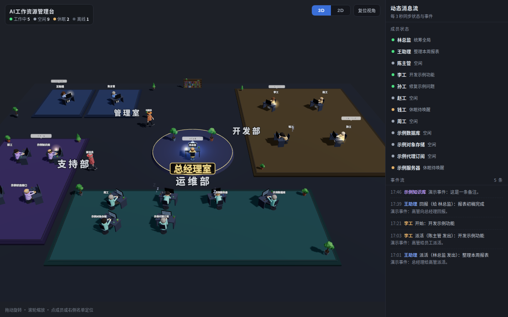
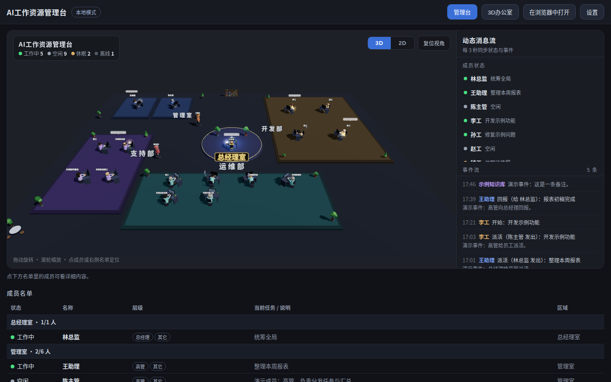
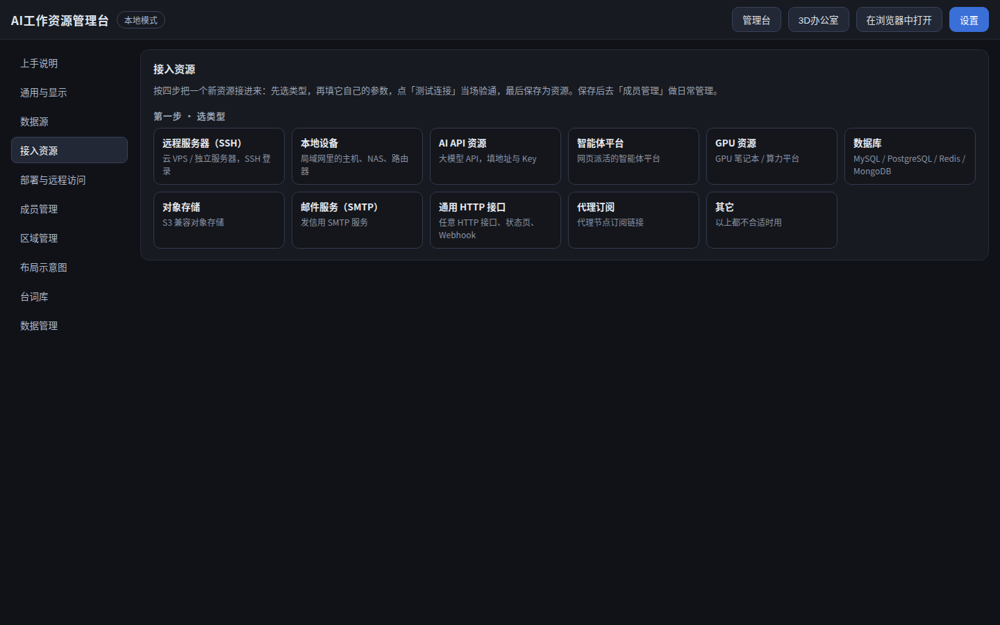
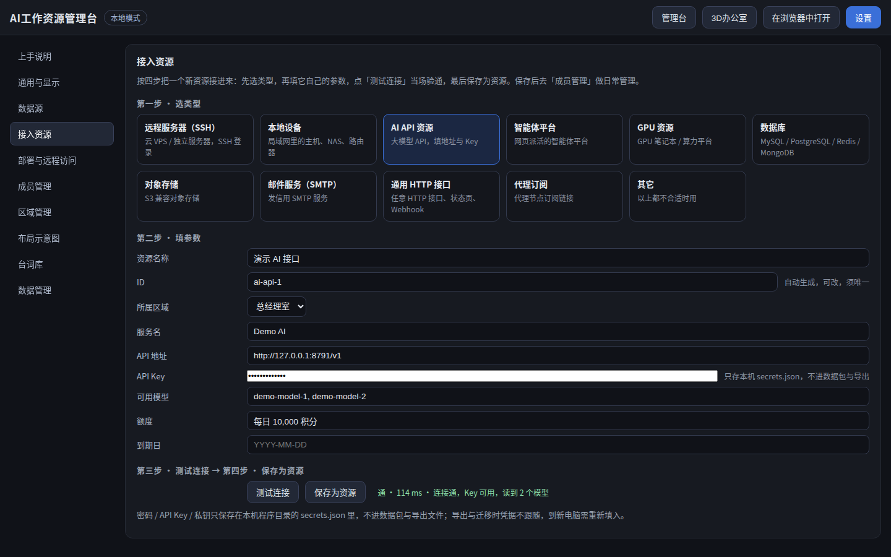
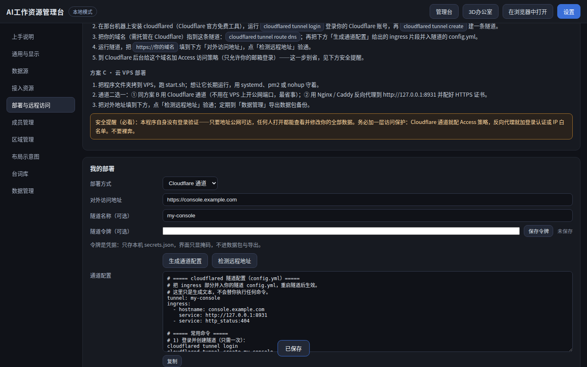
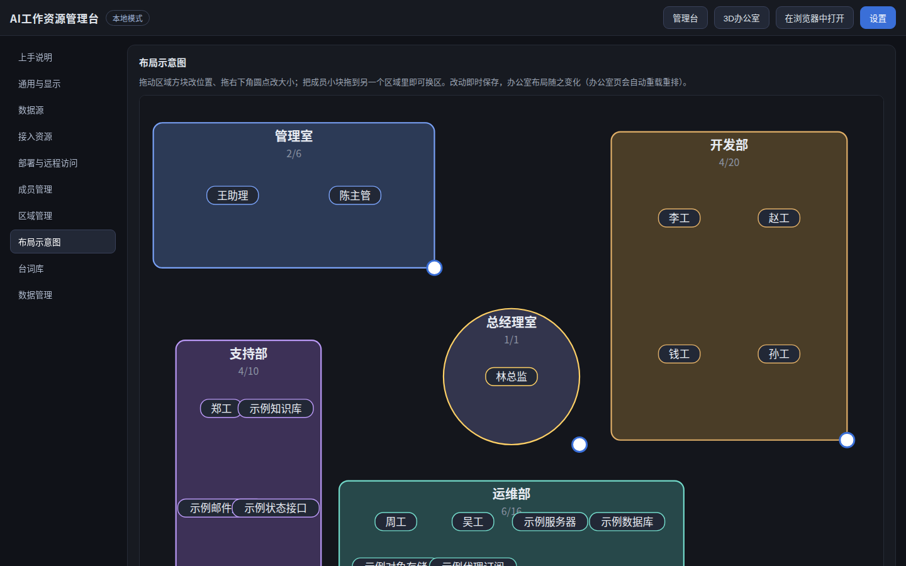

# AI Resource Console · AI工作资源管理台

[中文说明](README.zh-CN.md)

A standalone, local-first console for managing a team of AI workers / compute resources — with a live 3D office view. Everything runs on your own computer: no account, no cloud, no build step. Copy the folder anywhere, start it, and it works.



## Features

- **Console**: member list grouped by zones, live status (working / idle / sleeping / offline), current task, and a detail drawer per member.
- **3D office**: an embedded 3D/2D office where every member has a desk. Working members type with their desk lamp on, sleeping members lie on their desks, supervisors patrol and "wake" sleepers or "urge" idlers with speech bubbles, and dispatch/feedback events fly across the room as letters along the management hierarchy.
- **Full settings center** (no code or file editing needed):
  - **Add a Resource wizard**: the main way to bring a resource in — pick one of eleven types, fill in that type's parameters, test the connection on the spot, then save it as a resource (see "Add your first resource").
  - **Members**: day-to-day management — edit / delete members, change head-label name, zone, tier (GM / executive / staff), who they report to, status, and rich detail fields; single-member import / export also lives here.
  - **Deployment & remote access**: three ways to run the console so you can open it from anywhere, with a tunnel-config generator and a remote-URL checker (see "Deployment & remote access").
  - **Zones**: add / edit / delete zones — names (ZH/EN), capacity, size, position, colors, layout style (grid desks / individual plots / round hall).
  - **Layout map**: drag zones to move, drag the corner handle to resize, drag member chips between zones — the 3D office re-layouts itself automatically.
  - **Display & lines**: UI language ZH/EN, speech-bubble toggle, name-label toggle, and a fully editable lines library (wake / work / urge lines, both languages).
  - **Data source**: Local mode (fully editable, offline) or Live mode (read-only, see below).
  - **Data management**: export / import a JSON data package, restore factory demo data, or clear everything and start over.
- **Scales with you**: nothing is hardcoded — add members and zones freely (50+ members and extra zones are fine); desks are generated automatically, and you can enlarge a zone or add a new one whenever a zone fills up.
- **Portable**: all state lives in one `data.json` next to the program. Export a data package on one computer, import it on another, and everything (members, zones, relations, all settings) is restored. The one exception is credentials: passwords and API keys never leave the computer that stored them, so you re-enter them once after a move (see "Credentials stay on this computer").

## Quick start

You need **Python 3** (standard library only, no packages to install).

- **Windows**: double-click `start-windows.bat`
- **macOS**: double-click `start-mac.command` (first time: right-click → Open)
- **Linux**: `./start.sh`

A browser window opens at `http://127.0.0.1:8931/`. Keep the small console window running while you use it; close it (or press Ctrl+C) to stop.

> Do not open the HTML files directly — the pages load data through the local service, so always use the start script.

The app ships with neutral demo data (17 demo members in five demo zones) so you can explore every feature immediately. Make it yours in **Settings**, or clear it and start from scratch under Settings → Data.

## Add your first resource

Everything you manage here is a "member" (a resource). The main way to add one is the **Add a Resource** wizard in the settings sidebar — no hand-written JSON needed just to add a single VPS or API key. It is a four-step flow:

1. **Pick a type** — eleven kinds (listed below); each has its own parameter form.
2. **Fill in that type's parameters** — host/port/credentials for a server, base URL and key for an API, and so on.
3. **Test connection** — the server side probes the resource right away and reports reachable / rejected / unreachable, with latency.
4. **Save as resource** — it joins the member list; from then on, day-to-day edits (name, zone, tier, status, task) happen under **Members**.

(The member form keeps the same type picker and test button as a secondary entry point — both share one field definition and one test endpoint.)

### The eleven types

- **Remote server (SSH)** — a cloud VPS or dedicated server. Host (IP or hostname), SSH port (default 22), username, and how you log in (password or key); provider, region, specs and an expiry date are optional but handy. The test opens a TCP connection and reads the SSH banner — it checks the server is *reachable*; it does **not** try to log in.
- **Local device** — a machine on your own network: a home NAS, router, or mini-PC. Same fields as SSH, but the host is the LAN address (e.g. `192.168.1.10`). The test likewise checks reachability only, not login.
- **AI API** — a model API you call with a key. API base URL (e.g. `https://api.example.com/v1`), the models you use, a quota note (e.g. "10,000 credits/day"), an expiry date if it has one, and the API key in the credential field. The test really calls the API (`GET /models`) with your key: a model list back means the key works; `401/403` means the key was rejected.
- **Agent platform** — a web-based agent or automation service you dispatch work to. Platform name, entry URL, your account ID (the username/email — *not* the password), how you dispatch work (web chat, API, …), and a quota note. The test fetches the entry URL: any HTTP response means the entry point is reachable (it does not log in).
- **GPU resource** — a GPU notebook or compute platform. Platform, account ID, entry URL, how you access it, and a quota note. The test likewise checks the entry URL is reachable.
- **Database** — a MySQL / PostgreSQL / Redis / MongoDB service. Engine, host, port (defaults per engine), username, database name, password in the credential field. The test connects over TCP and speaks the protocol greeting (MySQL handshake, Redis `PING`); for PostgreSQL / MongoDB it verifies TCP connectivity.
- **Object storage** — an S3-compatible bucket. Provider, endpoint, region, bucket, and the access key / secret key pair as credentials. The test sends a properly signed (SigV4) list request: `200` = works, `403` = endpoint alive but credentials rejected, `404` = bucket not found.
- **Mail service (SMTP)** — an SMTP account for sending mail. Host, port, encryption (SSL / STARTTLS / none), username, sender address, password in the credential field. The test connects, reads the `220` greeting and says `EHLO`.
- **Generic HTTP API** — any HTTP(S) endpoint: a status page, a webhook, your own service. URL, method (GET / HEAD / POST), auth (none / Bearer token / custom header), an optional expected status code. The test sends the request and reports the actual status code and latency.
- **Proxy subscription** — a proxy-node subscription link. Just the subscription URL (plus notes on traffic/expiry). The test downloads the subscription and counts the nodes it can recognize (`vmess` / `vless` / `trojan` / `ss` / `hysteria`): more than zero = works.
- **Other** — anything that does not fit the ten above. Free-form fields: platform, region, specs, role, access notes, an optional host or entry URL — if you filled one in, the test probes it (TCP for a host, HTTP for a URL); with neither, the test button just explains.

Every type can be tested. Each test result (time, OK/failed, latency, message) is saved on the member, and a note appears in the event stream — so you can later see when a resource was last verified. In the wizard, a test you ran before saving is carried into the new member's record.

### Credentials stay on this computer

Passwords, private keys and API keys are stored **only** in `secrets.json`, in the program folder on this computer (the file is git-ignored, and the app never sends it anywhere). `data.json` and every export file only record *that* a member has a credential (`hasSecret`), never the credential itself; the member form only ever shows a masked hint (the last 4 characters). The consequence: after you import a data package on another computer, members keep their "has a credential" mark, but you must **re-enter the credentials there once**. That is by design, not data loss.

### Moving a single member

Besides the whole-package export/import in Settings → Data, you can move members one by one: export a member from its form to a small `.member.json` file, and import that file on another install (or send it to a teammate). Single-member import **only ever adds** — it never overwrites: if the `id` is already taken it becomes `-2`, `-3`, …; if the member's zone does not exist there, it lands in the first zone. Single-member files never contain credentials either (see above).

## Deployment & remote access

Out of the box the console only listens on `127.0.0.1` of the machine it runs on. To open it from anywhere — office, road, phone — run it on an always-on machine and give it a public path. **Settings → Deployment & Remote Access** walks you through three setups:

- **Plan A · Local only (simplest)** — double-click the start script on your own computer and use it there. No tunnel, no domain, nothing to configure. It stops when the computer or the start window closes.
- **Plan B · Always-on home host + Cloudflare Tunnel (recommended)** — copy the program folder to an always-on home machine (mini PC, NAS, old laptop) and start it there; install `cloudflared` on that machine, log in to your Cloudflare account, create a tunnel, and point your domain (hosted on Cloudflare) at it. The program itself never needs a public port.
- **Plan C · Cloud VPS** — copy the folder to a VPS, run `start.sh`, and keep it alive with systemd / pm2 / nohup. For the public path, either use a Cloudflare Tunnel exactly like Plan B, or put Nginx / Caddy in front as a reverse proxy with HTTPS.

Two helpers live in that settings section:

- **Generate tunnel config** — from your public URL's domain and this instance's actual listening port, it generates the cloudflared `config.yml` ingress snippet plus the commands to run, ready to copy and paste. It only generates text — the program never runs external commands for you, and a tunnel token appears in the snippet as a placeholder, never as a real value.
- **Check remote URL** — the server fetches `{your public URL}/api/health` and confirms it is answered by *this* instance (each install has its own instance ID): it reports separately whether the URL checks out, belongs to a different install, returns something unexpected, or cannot be reached at all.

What you fill in there: the deployment mode, your public URL, an optional tunnel name, and an optional tunnel token. The token is a credential — it is stored only in this machine's `secrets.json`, shown masked, and never included in data packages or exports.

> **Security — read this:** this program has no login of its own. If the URL is publicly reachable, *anyone* who opens it can view and change all your data. Always put an access layer in front: a Cloudflare Access policy (e.g. only your own email may log in) for tunnels, or login auth / IP allow-listing for a reverse proxy. Never expose it bare.

## Data modes

- **Local mode** (default): data lives in `data.json` beside the program. Everything is editable. Works fully offline.
- **Live mode**: enter *your own* state/events endpoint URLs under Settings → Data Source. The office and lists then show live status read-only. If the endpoints are unreachable, the app shows a clear notice and falls back to local data — never a blank page. Member zone/tier assignment still follows the local member profiles with the same `id`; unknown members land in the first regular zone. Editing is done in Local mode.

### Live endpoint format

State endpoint (JSON):

```json
{
  "members": [
    { "id": "alice", "name": "Alice", "status": "working",
      "task": "Writing a report", "detail": "Team lead",
      "since": "2026-01-01T09:00:00+08:00", "reportsTo": "boss-id" }
  ]
}
```

`status` is one of `working` / `idle` / `sleepy` / `offline`.

Events endpoint (JSON Lines — one JSON object per line):

```json
{"ts":"2026-01-01T09:05:00+08:00","member":"alice","type":"task_start","from":"idle","to":"working","task":"Writing a report","by":"boss-id"}
{"ts":"2026-01-01T09:06:00+08:00","member":"alice","type":"dispatch","from":"boss-id","to":"alice","brief":"New task","detail":"Shown in the event panel","task":"New task","by":"boss-id"}
```

`type` is one of `status_change` / `task_start` / `task_done` / `task_update` / `note` / `dispatch` / `feedback`. For `dispatch`/`feedback`, `from`/`to` are member ids (letters fly along them — GM can dispatch to anyone, executives to anyone except the GM, staff to staff; feedback flies back along the original route). For other types, `from`/`to` are status names.

## Hierarchy & letters

Three tiers: **GM → everyone**, **executives → everyone except the GM (including each other)**, **staff ↔ staff**. Feedback returns along the original dispatch route. Set each member's tier and "reports to" in Settings → Members; letters in the 3D office follow these rules automatically.

## Project layout

```
server.py            local service (Python stdlib only): static files + data API + live-mode proxy
start-windows.bat    Windows launcher
start-mac.command    macOS launcher
start.sh             Linux launcher
seed.json            factory demo data (used to create data.json on first run; restore point)
data.json            your working data (created on first run; safe to back up / copy)
www/
  index.html         console + settings center
  office.html        office view (3D/2D)
  src/app.js         office renderer (three.js)
  src/console.js     console & settings logic
  src/store.js       data access layer
  vendor/            three.js (MIT, vendored — no CDN needed)
```

## Screenshots


*Console dashboard — the office at a glance plus the member list · 管理台主界面——顶部办公室一览与成员名单*


*Add a Resource, step 1 — eleven resource types to pick from · 接入资源第一步——十一类资源卡片*


*Steps 2–3 — parameters filled in, connection test passed (2 models read back) · 填好演示参数并测试通过——读到 2 个模型*


*Deployment & remote access — run it anywhere, with the generated Cloudflare tunnel config · 部署与远程访问——含生成的通道配置片段*


*Settings — drag zones and members on the layout map; the 3D office follows · 设置中心——可拖拽的布局示意图*

## Notes

- The local service binds to `127.0.0.1` only (ports 8931–8940, first free one wins) and is meant for single-user local use.
- `data.json` is git-ignored; `seed.json` is the versioned factory state.

## License

MIT. The vendored three.js is MIT-licensed by its authors.

## Credits

- **three.js** (MIT) — the 3D rendering library vendored in `www/vendor/`.
- **Pixel Agents** — inspiration for the virtual-office concept (no code used).
- **ajsahni/agents-office** and **HarnessMD/munder-difflin** — design references (ideas only, no code or assets).

Full attribution, license texts and the project owner are recorded in [CREDITS.md](CREDITS.md).
