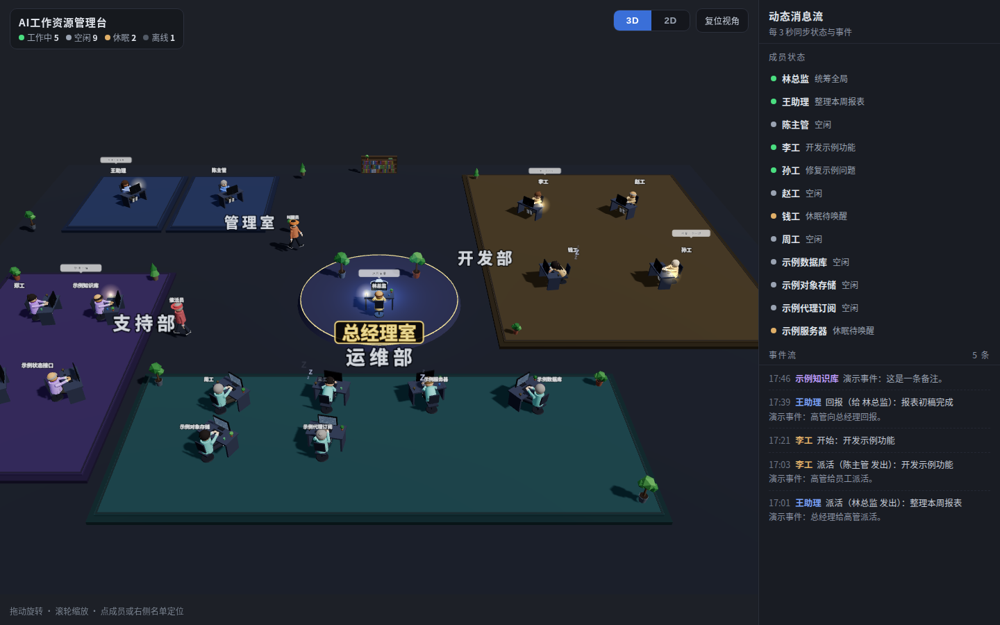
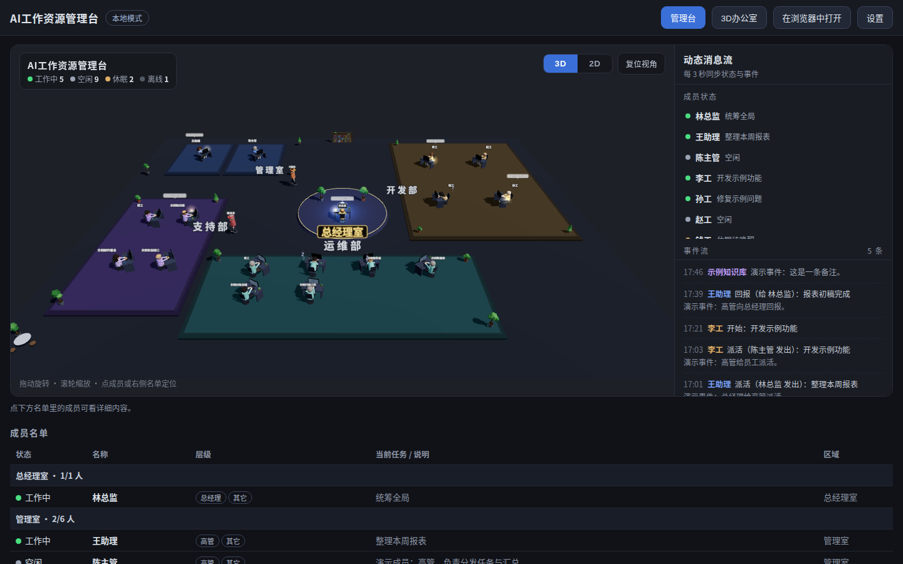
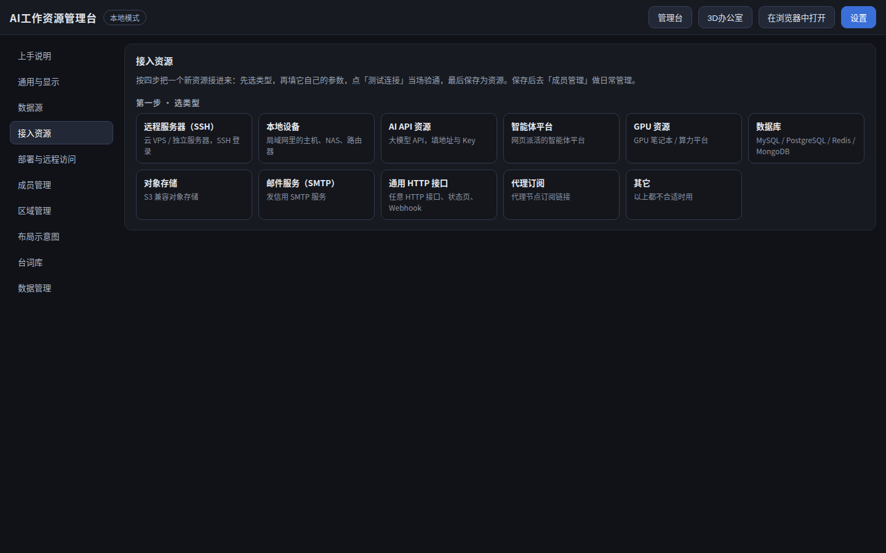
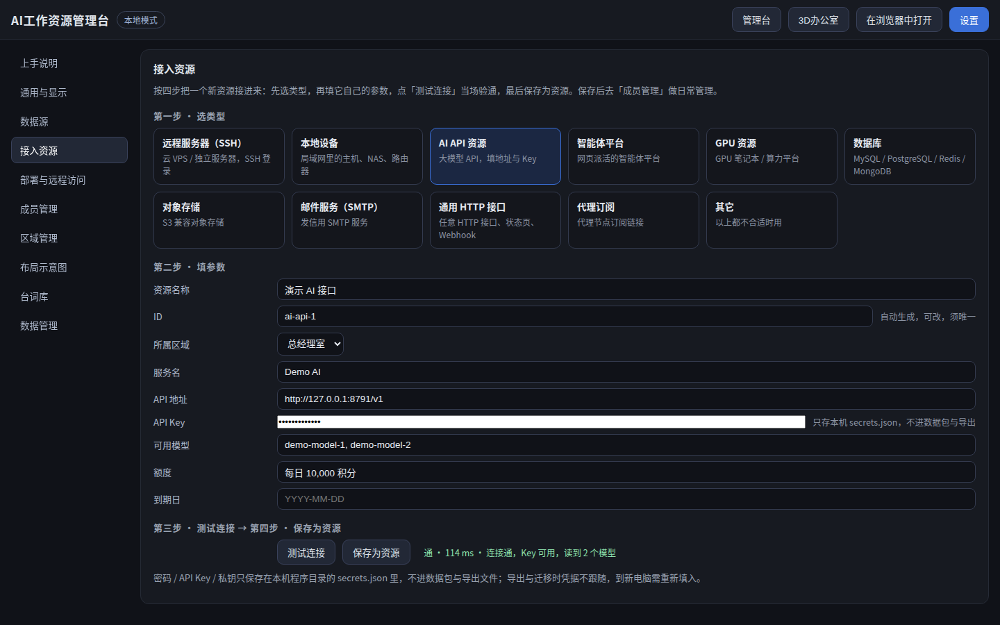
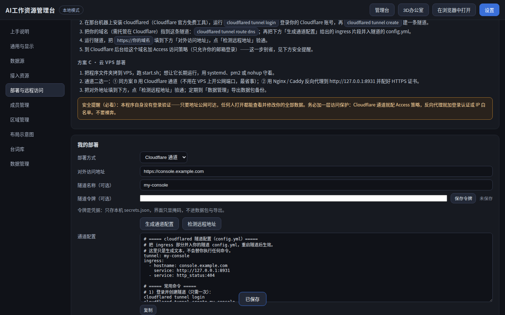
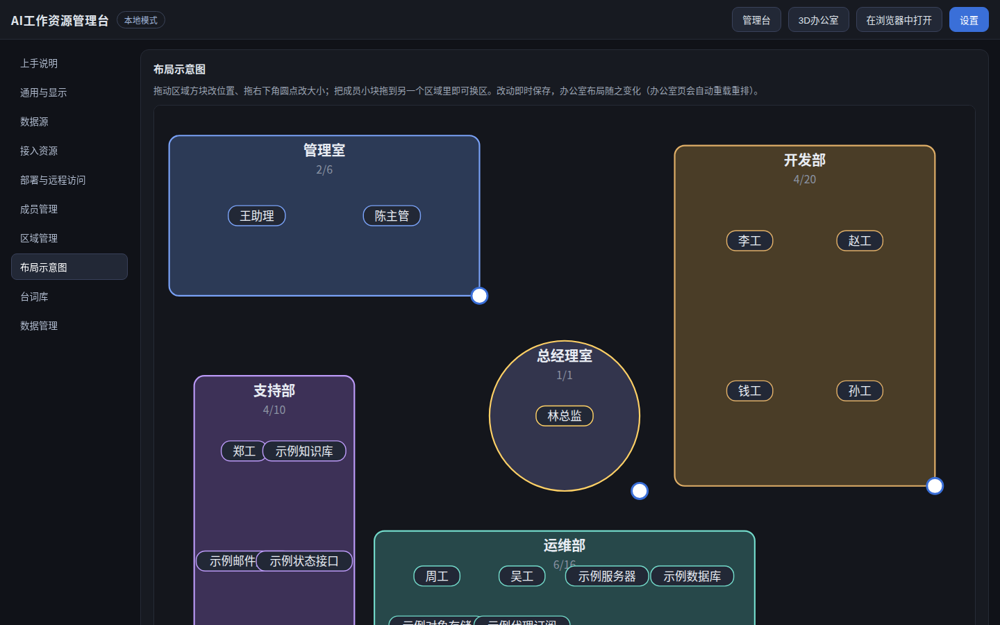

# AI工作资源管理台 · AI Resource Console

[English README](README.md)

一个能独立运行的本地管理台，用来管理一支由 AI 助手、自动化程序和计算资源组成的「团队」，并配有一间能实时呈现大家工作状态的 3D 办公室。

它为这样的场景而做：你手里有若干个 AI 助手、机器人、服务器或云资源，想在一个地方看清谁在忙、谁在闲、谁在睡、谁掉线了，谁该向谁汇报，任务是怎么派下去的——就像管理一间真正的办公室。

**本地优先**：不注册账号、不用云服务、不需要构建步骤。把整个文件夹拷到任何一台电脑上，点一下启动脚本就能用，离线也能用。



## 功能一览

- **管理台**：成员按区域分组列出，每人的状态（工作中 / 空闲 / 休眠 / 离线）、当前任务一目了然，点开还有详情抽屉。
- **3D 办公室**：每位成员在办公室里都有一张工位。工作中时坐着打字、台灯亮着；休眠时趴在桌上睡觉；还有两名「监工」在场内巡逻——叫醒员负责叫醒睡着的人，催活员负责催空闲的人，头顶都会冒出说话气泡。派活和回报会变成一封信，沿着上下级关系在办公室里飞来飞去。
- **完整的设置中心**：所有配置都在界面里完成，不需要改代码、不需要编辑文件（逐项说明见下方「设置说明」）。
- **人数可扩展**：成员和区域的数量都没有写死。加人时工位自动生成；区域满了可以在设置里把区域拉大，或者再新增一个区域。几十个人也排得下。
- **数据可携带**：全部数据就存在程序旁边的一个 `data.json` 文件里。在一台电脑上导出数据包，在另一台电脑上导入，成员、区域、上下级关系和全部设置完整还原。

## 安装

你只需要 **Python 3**（用到的都是标准库，不用安装任何第三方包）。

1. 把本项目文件夹（或从 Releases 下载的压缩包解压后）放到你喜欢的位置。
2. 不用装任何东西，直接看下一步启动。

> 提示：Windows 自带 Python 的情况不一。如果双击启动脚本后闪退，请先到 python.org 或 Microsoft Store 安装 Python 3，并在安装时勾选「Add Python to PATH」。

## 启动

- **Windows**：双击 `start-windows.bat`
- **macOS**：双击 `start-mac.command`（第一次打开如果被系统拦截，请右键点它 →「打开」）
- **Linux**：在文件夹里运行 `./start.sh`

启动后浏览器会自动打开 `http://127.0.0.1:8931/`（如果该端口被占用，程序会自动在 8931–8940 之间挑一个空闲端口，实际地址会显示在启动窗口里）。

使用期间请不要关掉那个小的启动窗口；想退出时关掉它，或者在窗口里按 `Ctrl+C`。

> **不要直接双击 HTML 文件打开**——页面需要通过本地服务读取数据，一定要用启动脚本。

程序自带一套中性的演示数据（17 位演示成员、五个演示区域），打开就能把全部功能点一遍。想换成你自己的团队，去「设置」里改，或者在「设置 → 数据」里清空重来。

## 添加你的第一个资源

你管理的每一样东西，在这里都叫「成员」（资源）。添加资源的主路径是设置中心侧栏里的 **「接入资源」向导页**，不需要你为了加一台 VPS 或一个 API Key 去手写 JSON 文件。向导分四步：

1. **选类型**——共十一类（见下），每一类有自己的参数表单；
2. **填参数**——服务器填主机、端口、凭据，API 填接口地址和 Key，照着表单填即可；
3. **测试连接**——程序从服务端当场去探这个资源，通不通、被拒还是连不上，连同耗时一起报给你；
4. **保存为资源**——它就进入成员名单；之后改名、换区、调层级和状态这些日常维护，去「成员管理」里做。

（成员表单里保留了同一套类型选择与测试按钮作为次要入口，两边共用同一份字段定义和同一个测试接口。）

### 十一种类型

- **远程服务器（SSH）**：云 VPS、独立服务器这类。填主机（IP 或域名）、SSH 端口（默认 22）、登录用户名、验证方式（密码或私钥）；服务商、地区、规格、到期日可选，建议填上，方便日后查看。点「测试连接」会连一下这台机器并读它的 SSH 欢迎信息——**只验能不能连通，不验能不能登录**。
- **本地设备**：自己局域网里的机器，比如家里的 NAS、路由器、小主机。字段和 SSH 一样，只是主机填内网地址（如 `192.168.1.10`）。测试同样只验可达、不验登录。
- **AI API**：用 Key 调用的大模型 API。填 API 基础地址（如 `https://api.example.com/v1`）、可用模型、额度说明（如「每日 10,000 积分」）、到期日（如有）；把 API Key 填进凭据栏。「测试连接」会真的拿你的 Key 去调一次接口（请求模型列表）：能返回模型列表＝Key 可用；返回 401/403＝Key 被拒。
- **智能体平台**：在网页上派活的智能体 / 自动化平台。填平台名、入口网址、账号标识（用户名 / 邮箱等，**不是**密码）、派活方式（网页聊天 / API 等）、额度说明。测试会去打开它的入口网址：收到任何 HTTP 响应就算入口可达（不验登录）。
- **GPU 资源**：GPU 云笔记本、算力平台。填平台、账号标识、入口网址、接入方式、额度说明。测试同样验入口网址可达。
- **数据库**：MySQL / PostgreSQL / Redis / MongoDB 服务。选引擎，填主机、端口（默认随引擎）、用户名、库名，密码填进凭据栏。测试会连上去走一遍协议问候（MySQL 握手、Redis 发 PING）；PostgreSQL / MongoDB 只验 TCP 连通。
- **对象存储**：S3 兼容的对象存储。填服务商、Endpoint、区域、Bucket，Access Key / Secret Key 填进凭据栏。测试会带正规签名（SigV4）发一次列举请求：200＝通；403＝端点在但凭据被拒；404＝Bucket 不存在。
- **邮件服务（SMTP）**：用来发信的 SMTP 服务。填主机、端口、加密方式（SSL / STARTTLS / 无）、用户名、发件地址，密码填进凭据栏。测试会连上去读 `220` 问候并打一声 `EHLO` 招呼。
- **通用 HTTP 接口**：任意 HTTP(S) 接口——状态页、Webhook、自家服务的接口都行。填 URL、方法（GET / HEAD / POST）、鉴权方式（无 / Bearer Token / 自定义请求头），可选填期望状态码。测试会真的发一次请求，报回实际状态码与耗时。
- **代理订阅**：代理节点订阅链接。填订阅地址即可（流量 / 到期说明可备注）。测试会把订阅拉下来数一遍能识别出的节点条数（vmess / vless / trojan / ss / hysteria）：数到节点＝通。
- **其它**：以上十类都不合适的，自由填写平台、地区、规格、职责、接入方式等；顺手填了主机或入口网址的话，测试会去探它（填主机走 TCP、填网址走 HTTP），都没填时测试按钮只给说明。

十一类全都可以测。每次测试结果（时间、通 / 不通、耗时、说明）都会保存在成员身上，事件流里也会多一条记录，方便你日后看它上次验通是什么时候；在向导里先测后存的，这次结果会一并写进新成员的记录。

### 凭据只存在这台电脑上

密码、私钥、API Key 这类凭据**只**保存在程序文件夹里的 `secrets.json`，只存在这台电脑上（该文件已被 `.gitignore` 排除，程序也不会把它发到任何地方）。`data.json` 和一切导出文件里只记「这个成员存有凭据」（`hasSecret`）这个标记，绝不含凭据本身；成员表单里也只显示掩码提示（末 4 位）。所以：把数据包导入到另一台电脑后，成员身上「有凭据」的标记还在，但你需要**在新电脑上重新填一次凭据**——这是有意的设计，不是数据丢了。

### 单个成员的导入导出

除了「设置 → 数据」里的整包导出 / 导入，还可以一个一个搬成员：在成员表单里把某位成员导出成一个小的 `.member.json` 文件，在另一处安装里（或发给同事）导入。单个导入**只新增、永不覆盖**：`id` 撞车会自动改成 `-2`、`-3`……；成员的区域在那边不存在时，先落到第一个区域。单个成员文件同样不含凭据明文（见上）。

## 部署与远程访问

开箱状态下，程序只监听所在机器的 `127.0.0.1`，只能在本机打开。想在异地（公司、路上、手机上）也能顺畅打开，就要把它跑在一台常开的机器上，再给它一条公网通道。「设置 → 部署与远程访问」里有三种跑法，任选其一：

- **方案 A · 本机自用（最简单）**：就在自己电脑上双击启动脚本用。不需要通道、不需要域名，什么都不用填；电脑关机或关掉启动窗口就打不开了。
- **方案 B · 家里常开小主机 ＋ Cloudflare 通道（推荐）**：把整个程序文件夹拷到一台常开的家里机器（小主机、NAS、旧电脑都行），在上面跑启动脚本；再在那台机器上装 `cloudflared`（Cloudflare 官方免费工具），登录你的 Cloudflare 账号、建一条隧道，把你的域名（需托管在 Cloudflare）指过去。程序本身不用开任何公网端口。
- **方案 C · 云 VPS 部署**：把文件夹拷到 VPS 上跑 `start.sh`，用 systemd、pm2 或 nohup 让它长期运行。公网通道二选一：① 同方案 B 用 Cloudflare 通道（不用开公网端口，最省事）；② 用 Nginx / Caddy 反向代理到本机端口并配好 HTTPS。

这一节里还有两个顺手的工具：

- **「生成通道配置」**：按你填的对外地址的域名 ＋ 本机实例实际监听的端口，生成 cloudflared 的 `config.yml` ingress 片段和要跑的命令，点一下就能复制，粘贴到隧道配置里即可。它只生成文本，程序不会替你执行任何命令；隧道令牌在片段里只以占位符出现，绝不出现真值。
- **「检测远程地址」**：程序会去请求 `{你的对外地址}/api/health`，并核对回应的实例标识是不是本机这一份（每份部署的标识各不相同）：是本机才算验通；是另一份部署、回应格式不对、连不上，这几种情况会分别给出明确说法。

要填的就四样：部署方式、对外访问地址、隧道名称（可选）、隧道令牌（可选）。其中令牌是凭据，只存本机 `secrets.json`，界面只显掩码，绝不进数据包与导出。

> ⚠️ **安全提醒（必看）**：本程序自身没有登录验证——只要地址公网可达，任何人打开都能查看并修改你的全部数据。务必加一层访问保护：Cloudflare 通道就配 Access 策略（比如只允许你自己的邮箱登录），反向代理就加登录认证或 IP 白名单。不要裸奔。

## 界面说明

- **顶部按钮**：「3D 办公室」在当前页打开办公室视图；「在浏览器中打开」在新标签页打开同一个办公室；「设置」打开设置中心。
- **成员名单**：按区域分组，每行是状态色点＋名字＋当前任务；点任意成员打开详情抽屉，并可在办公室里定位到他的工位。
- **事件流**：右侧面板记录状态变化、派活、回报和备注，按时间倒序；点某个成员可以只看和他有关的事件。
- **办公室（3D / 2D）**：右上角可切换 3D 与 2D 俯视图。3D 里可以拖动旋转、滚轮缩放、点小人定位。台灯亮＝工作中，趴桌睡觉＝休眠或离线（离线时名字变灰）。

## 设置说明（逐项）

打开「设置」后，左侧是分类，改完即时生效并自动保存到 `data.json`。

### 接入资源（新增资源的主路径）

- **向导四步**：选类型（共十一类：远程服务器 / 本地设备 / AI API / 智能体平台 / GPU / 数据库 / 对象存储 / 邮件服务 / 通用 HTTP 接口 / 代理订阅 / 其它）→ 填该类型的参数 → 点「测试连接」当场验通 → 「保存为资源」。逐类该填什么、测试怎么验，见「添加你的第一个资源」。

### 部署与远程访问

- 三种跑法（本机自用 / 家里常开小主机＋Cloudflare 通道 / 云 VPS）、「生成通道配置」与「检测远程地址」两个工具、以及公网暴露必须加访问保护的安全提醒，见「部署与远程访问」一节。

### 成员

- **编辑 / 删除成员**（新增走上面的「接入资源」向导；成员表单里也能新增，并保留类型选择与测试按钮作为次要入口）：每个人可以设置——
  - **类型**：十一类之一（远程服务器 / 本地设备 / AI API / 智能体平台 / GPU / 数据库 / 对象存储 / 邮件服务 / 通用 HTTP 接口 / 代理订阅 / 其它），表单会按类型显示对应字段，逐类该填什么见「添加你的第一个资源」；
  - **头顶名称**：显示在办公室里人物头顶和名单里的名字；
  - **所属区域**：他坐哪个区域；
  - **层级**：总经理 / 高管 / 员工（三层，决定派活路线，见「上下级关系」）；
  - **上级**：他向谁汇报（总经理的上级为空）；
  - **状态**：工作中 / 空闲 / 休眠 / 离线；
  - **详细内容**：简介、职务、平台、所在地区、规格、接入方式、备注——这些会显示在成员详情里，用来记录「这是什么资源、怎么用」。
- 人数没有上限。新增成员后，办公室会自动给他排一张工位。

### 区域

- **新增 / 编辑 / 删除区域**：每个区域可以设置中文名、英文名、容纳人数、大小、位置、颜色，以及布局样式：
  - **网格工位**：普通大开间，工位自动成行成列；
  - **独立地块**：每人一小块地，适合放高管；
  - **圆形厅**：圆厅造型，适合放负责人单间。
- **区域大小**既可以直接填数字改，也可以在下面的布局图里拖。

### 布局示意图

设置里有一张平面示意图，和办公室的实际布局一一对应：

- **拖动区域方块**＝移动区域位置；
- **拖区域右下角的手柄**＝改变区域大小；
- **把成员小块拖到另一个区域**＝给成员换区。
- 保存后回到办公室，3D 布局会按示意图重新排布。

### 显示与台词

- **界面语言**：中文 / 英文一键切换，办公室和设置界面一起换；
- **头顶气泡开关**：关掉后人物头顶不再冒说话气泡；
- **名称显示开关**：关掉后头顶不显示名字；
- **台词库**：叫醒台词、打工台词、催活台词都可以自由编辑，中英文各一套，办公室里的人物会随机抽用。改完记得保持两边条数大致相当，切换语言时体验更一致。

### 上下级关系

三层结构，决定办公室里「派活信」能沿哪些路线飞：

- **总经理**：可以给任何人派活；
- **高管**：可以给总经理以外的任何人派活，高管之间也能互相派；
- **员工**：只能和员工之间互相派活；
- **回报**永远沿着当初派活的路线飞回去，所以员工和高管向总经理回报是正常的，不受上面的限制。

在「成员」设置里给每个人选好层级和上级即可，不需要别的操作。

### 数据源

- **本地模式**（默认）：数据就存在本机的 `data.json` 里，全部可编辑，完全离线可用。
- **实时模式**：如果你自己有后端能提供状态与事件接口，把**你自己的**接口地址填进来，办公室和名单就会只读地显示实时状态。程序不预置任何人的地址。接口格式见下方「数据源接口格式」。
  - 实时模式下成员的区域和层级，仍按本地成员资料里同 `id` 的配置归位；接口里出现的新成员会先落到第一个普通区域，你回本地模式给他建档即可。
  - 接口连不上时，界面会明确提示，并自动退回显示本地数据，不会白屏。
  - 想编辑数据时，切回本地模式改。

### 数据管理

- **导出数据包**：把当前全部数据（成员、区域、关系、设置、台词）导出成一个 JSON 文件；
- **导入数据包**：在另一台电脑上导入这个文件，即可完整还原——换电脑、备份、分享给同事一套配置都靠它；
- **恢复演示数据**：一键回到出厂自带的演示团队；
- **清空重来**：删掉所有成员和区域（区域会保留最基本的空壳结构），从零搭建你自己的团队。

> ⚠️ 导出的数据包里可能包含你填过的接入方式、备注等敏感信息，请像保管密码一样保管它，不要随手发到公开场合。本项目的 `.gitignore` 已经默认把数据包和 `data.json` 挡在版本库之外。另外说明：密码、私钥、API Key 这类凭据**从不**写进数据包——它们只存在本机的 `secrets.json` 里，换电脑导入后要给每个成员重新填一次凭据，详见「添加你的第一个资源」。

## 数据源接口格式（实时模式）

你的后端只需要提供两个只读地址（HTTP GET，返回 JSON / JSONL 即可，不需要任何鉴权约定，用不用鉴权由你自己的部署决定）。

**状态接口**返回一个 JSON 对象：

```json
{
  "members": [
    { "id": "alice", "name": "Alice", "status": "working",
      "task": "正在写周报", "detail": "运营组组长",
      "since": "2026-01-01T09:00:00+08:00", "reportsTo": "boss-id" }
  ]
}
```

- `status` 只能是 `working`（工作中）/ `idle`（空闲）/ `sleepy`（休眠）/ `offline`（离线）四者之一；
- `id` 要和本地成员资料里的 `id` 对得上，才能正确归位到区域和层级。

**事件接口**返回 JSON Lines（一行一个 JSON 对象）：

```json
{"ts":"2026-01-01T09:05:00+08:00","member":"alice","type":"task_start","from":"idle","to":"working","task":"正在写周报","by":"boss-id"}
{"ts":"2026-01-01T09:06:00+08:00","member":"alice","type":"dispatch","from":"boss-id","to":"alice","brief":"新任务","detail":"面板里显示的详情","task":"新任务","by":"boss-id"}
```

- `type` 可选：`status_change` / `task_start` / `task_done` / `task_update` / `note` / `dispatch` / `feedback`；
- `dispatch`（派活）和 `feedback`（回报）时，`from` / `to` 是成员 `id`，办公室会按上下级路线飞信；其它类型时 `from` / `to` 是状态名；
- `brief` 是显示在信封上的一句话摘要，`detail` 是只在事件面板里展开的详情。

## 文件说明

| 文件 | 作用 |
| --- | --- |
| `server.py` | 本地服务（只用 Python 标准库）：提供页面、数据读写和实时模式转发 |
| `start-windows.bat` / `start-mac.command` / `start.sh` | 三个平台的启动脚本 |
| `seed.json` | 出厂演示数据，首次运行时用来生成 `data.json`，也是「恢复演示数据」的还原点 |
| `data.json` | 你的工作数据（首次运行自动生成），备份和迁移主要就是备份它 |
| `www/` | 页面与办公室渲染代码（three.js 已内置，不依赖任何 CDN） |
| `docs/` | 仓库结构说明与发布前隐私自查清单（给维护者用） |

更细的仓库结构说明见 [docs/REPO-LAYOUT.md](docs/REPO-LAYOUT.md)。

## 常见问题

**双击启动脚本闪退 / 提示找不到 Python？**
先安装 Python 3。Windows 安装时记得勾选「Add Python to PATH」；装完重新双击脚本。

**macOS 提示「无法打开，因为无法验证开发者」？**
右键点 `start-mac.command` → 选「打开」，在弹出的对话框里再点「打开」即可，只需要做一次。

**直接双击 `www/index.html` 为什么是空白或报错？**
页面要通过本地服务读数据，`file://` 打开拉不到数据。请始终用启动脚本打开。

**端口被占用怎么办？**
不用管。程序会自动在 8931–8940 里找一个空闲端口，启动窗口里会写明实际地址。

**实时模式连不上 / 一片空白？**
先确认你填的地址能在浏览器里直接打开并返回正确格式的数据。连不上时程序会提示并退回本地数据；切回本地模式检查成员 `id` 是否与接口对得上。

**换电脑后怎么恢复我原来的团队？**
在旧电脑「设置 → 数据」导出数据包，把文件拷到新电脑，打开程序后在同一位置导入。或者更简单：直接把旧电脑的 `data.json` 拷到新电脑程序文件夹里覆盖同名文件。注意：密码和 API Key 不会跟着走（它们只存在旧电脑的 `secrets.json` 里），到新电脑后要给每个成员重新填一次凭据，成员表单会提醒你哪些还没填。

**数据存在哪儿？会不会上传到什么地方？**
只存在程序文件夹里的 `data.json`。本程序不联网、不收集任何信息（实时模式下只会去连你在设置里亲手填的那个地址）。

**人加多了办公室会不会卡？**
工位和人物都是轻量模型，几十人的规模在普通电脑上没有问题。真要加到上百人，可以把不常用的人状态设为离线，或拆成几个区域分散摆放。

**能不能放到常开的机器上、异地也能打开？**
可以，见「部署与远程访问」：把程序跑在家里常开小主机或云 VPS 上，再用 Cloudflare 通道（或反向代理）给它一个对外地址，填回设置里点「检测远程地址」验通即可。注意程序本身仍是单人工具、没有登录验证，公网可达时务必按那一节的提醒加 Access 之类的访问保护。另外也可以在那台机器上接你的实时接口、用实时模式只读展示。

## 截图


*管理台主界面——顶部办公室一览与成员名单 · Console dashboard — the office at a glance plus the member list*


*接入资源第一步——十一类资源卡片 · Add a Resource, step 1 — eleven resource types to pick from*


*填好演示参数并测试通过——读到 2 个模型 · Steps 2–3 — parameters filled in, connection test passed (2 models read back)*


*部署与远程访问——含生成的通道配置片段 · Deployment & remote access — with the generated Cloudflare tunnel config*


*设置中心——可拖拽的布局示意图 · Settings — drag zones and members on the layout map; the 3D office follows*

## 隐私与安全

- 本地服务只绑 `127.0.0.1`，默认不对局域网和公网开放；若你按「部署与远程访问」把它对外，访问保护（Cloudflare Access / 登录认证 / IP 白名单）必须自己加上，程序没有内置登录；
- 程序没有任何遥测和统计；
- 仓库里只有中性的演示数据。发布或提交代码前，请按 [docs/RELEASE-PRIVACY-CHECKLIST.md](docs/RELEASE-PRIVACY-CHECKLIST.md) 自查一遍，别把自己的 `data.json`、数据包或任何密钥带进版本库。

## 许可证

MIT。内置的 three.js 为其作者的 MIT 许可作品。

## 致谢

- **three.js**（MIT）—— 内置于 `www/vendor/` 的 3D 渲染库。
- **Pixel Agents** —— 「虚拟办公室」概念的灵感来源（未使用其代码）。
- **ajsahni/agents-office** 与 **HarnessMD/munder-difflin** —— 设计参考（只借设计，未使用代码或素材）。

完整的署名、许可证文本与项目所有者记录在 [CREDITS.md](CREDITS.md)。
